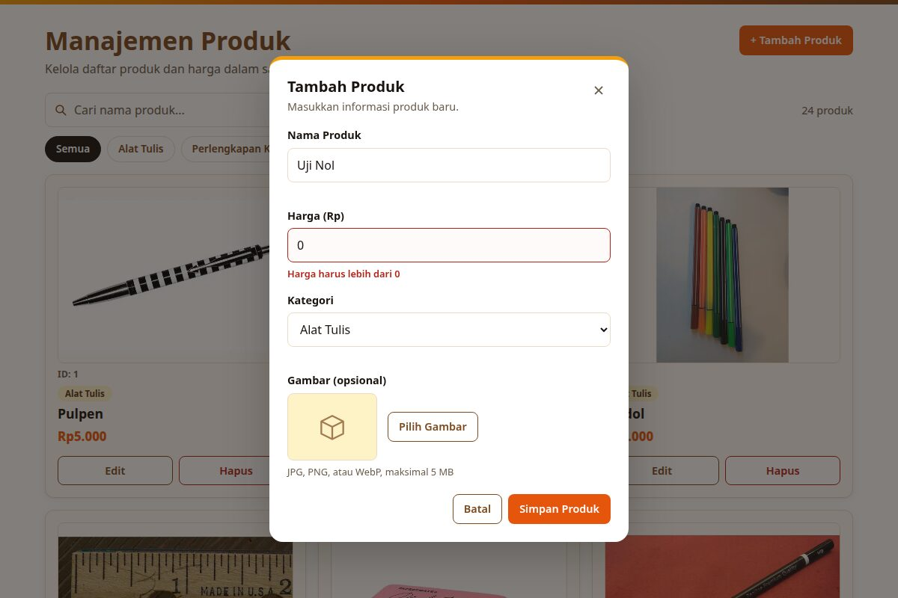
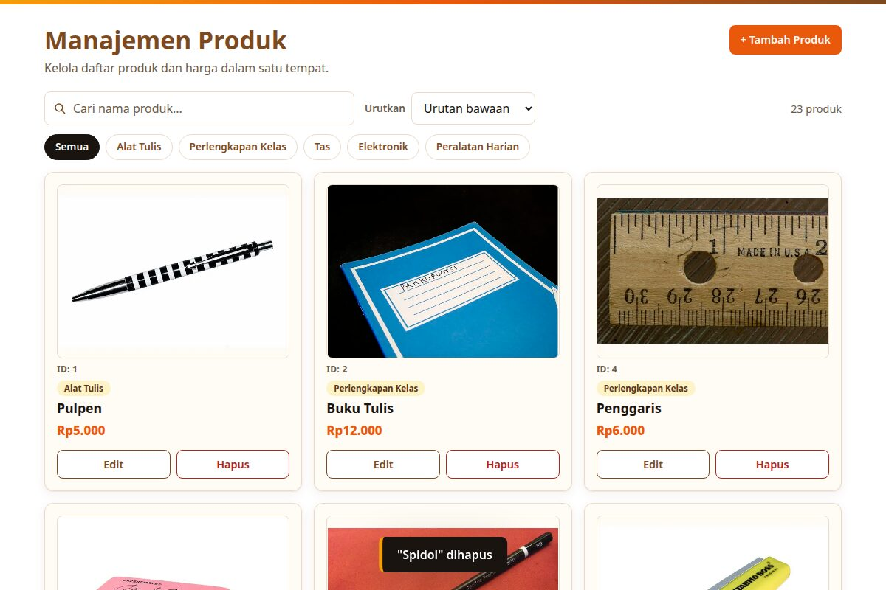
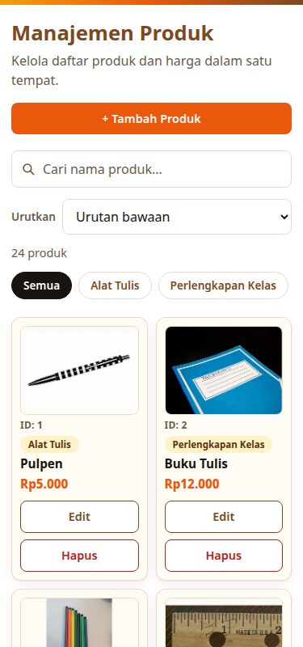

# Manajemen Produk

Aplikasi web satu halaman untuk mengelola daftar produk dan harganya, dibuat dengan React. Pengguna dapat mencari, menyaring, mengurutkan, menambah, mengubah, dan menghapus produk, dan semua perubahan tersimpan di peramban.

| | |
|---|---|
| Mata kuliah | Pemrograman Web |
| NRP | 5027251091 |
| Tugas | Tugas 3, Fundamental React |
| Teknologi | React 19 (JavaScript/JSX), Vite, CSS biasa |

## Cara menjalankan

Prasyarat: Node.js (LTS) dan npm.

```bash
npm install
npm run dev        # buka http://localhost:5173
npm run build      # build produksi ke folder dist/
npm run preview    # menjalankan hasil build untuk dicoba
```

## Fitur

### Inti Tugas

- Header "Manajemen Produk" dengan tombol **+ Tambah Produk**.
- Kolom pencarian "Cari nama produk...", penghitung "N produk", dan "Menampilkan X dari Y produk".
- Kartu produk: ID, nama, harga berformat rupiah, tombol **Edit** dan **Hapus**.
- Pop-up **Tambah Produk**, **Edit Produk** (terisi data lama), dan **Hapus Produk?** (menampilkan produk dan peringatan tidak dapat dikembalikan).
- Validasi: nama wajib; harga harus angka bulat lebih dari 0.

### Fitur extra

- Kategori produk (Alat Tulis, Perlengkapan Kelas, Tas, Elektronik, Peralatan Harian) dengan tombol filter.
- Katalog 24 produk bertema kehidupan sekolah dengan foto nyata (kredit dan lisensi di [`KREDIT-GAMBAR.md`](KREDIT-GAMBAR.md)).
- Gambar produk bersifat opsional: bisa diunggah saat tambah atau edit (diperkecil otomatis), produk tanpa gambar memakai gambar pengganti.
- Pengurutan nama dan harga.
- Data tersimpan di `localStorage` dan bertahan setelah muat ulang; tombol **Reset ke data awal**.
- Pemberitahuan (toast), tampilan saat hasil kosong, tombol Esc menutup pop-up.

## Gaya tampilan

- Latar putih dengan aksen kuning, oranye, cokelat, dan hitam: judul cokelat, tombol utama oranye, harga oranye, filter aktif hitam, dan garis gradasi kuning ke cokelat di tepi atas halaman.
- Seluruh warna, radius sudut, bayangan, dan jenis huruf didefinisikan sebagai variabel CSS di [`src/styles/theme.css`](src/styles/theme.css), sehingga tema dapat diubah dari satu berkas.
- Tampilan responsif: pada layar sempit kartu disusun dua kolom, tombol filter dapat digeser ke samping, dan tombol **+ Tambah Produk** memenuhi lebar layar.
- Aksesibilitas dasar: cincin fokus kuning untuk papan ketik, label dan pesan galat terhubung ke kolomnya, target sentuh minimal 44 px pada layar sentuh.

## Fungsi utama

- **Menampilkan produk.** Daftar yang tampil dihitung dari data lengkap: disaring menurut kata kunci dan kategori, lalu diurutkan. Penghitung di atas menunjukkan seluruh produk, sedangkan ringkasan di bawah menunjukkan jumlah yang sedang tampil.
- **Mencari, menyaring, mengurutkan.** Pencarian tidak peka huruf besar-kecil dan mengabaikan spasi di tepi; filter kategori dan pencarian berlaku bersamaan; urutan tersedia menurut ID, nama (A-Z, Z-A), dan harga.
- **Menambah dan mengubah.** Form yang sama dipakai untuk keduanya. Nama wajib diisi (maksimal 60 karakter), harga harus angka bulat lebih dari 0, dan kategori dipilih dari daftar. Pesan galat muncul di bawah kolom yang bermasalah dan pop-up tetap terbuka sampai isian benar.
- **Gambar opsional.** Gambar yang diunggah diperkecil di peramban (sisi terpanjang 600 piksel) sebelum disimpan; berkas yang bukan gambar atau lebih dari 5 MB ditolak.
- **Menghapus.** Penghapusan selalu meminta konfirmasi yang menampilkan produk yang akan dihapus.
- **Menyimpan.** Setiap perubahan disimpan ke `localStorage`. Bila data tersimpan rusak, aplikasi kembali memakai data awal; bila penyimpanan penuh, muncul peringatan dan aplikasi tetap berjalan.
- **Reset.** Tombol **Reset ke data awal** mengembalikan 24 produk awal setelah konfirmasi.

## Struktur folder

```text
src/
  components/
    atoms/        Tombol, Lencana, GambarProduk
    molecules/    KotakCari, FilterKategori, PilihUrutan, BarPencarian,
                  KolomIsian, KolomPilihan, KolomGambar
    organisms/    KartuProduk, GridProduk, HeaderHalaman, Modal, FormProduk,
                  DialogHapus, KeadaanKosong, Toast
    templates/    TataLetak
    pages/        HalamanProduk
  data/           produk.js, kategori.js
  utils/          format, validasi, saring, urut, penyimpanan, gambar
  styles/         theme.css, base.css
public/images/produk/   foto produk (WebP)
docs/bukti/             tangkapan layar aplikasi
```

Komponen dikelompokkan menurut ukurannya (atoms, molecules, organisms, templates, pages). Seluruh data dipegang oleh `HalamanProduk` dan dibagikan ke komponen di bawahnya lewat props; komponen anak memberi tahu halaman melalui fungsi yang diterima sebagai props.

## Tampilan aplikasi

Halaman utama:


Form tambah produk dengan pesan galat saat harga 0:



Setelah produk dihapus (jumlah produk berkurang dan muncul pemberitahuan):



Tampilan layar ponsel (375 px):



Tangkapan layar lainnya ada di [`docs/bukti/`](docs/bukti/).

## Catatan

- Harga produk hanya contoh.
- Foto berasal dari Wikimedia Commons dengan lisensi bebas; atribusi lengkap di `KREDIT-GAMBAR.md`. Foto Ransel Sekolah adalah ransel trekking karena tidak ada foto ransel sekolah berlisensi bebas yang bersih.
- Data tersimpan hanya di peramban pengguna (`localStorage`, sekitar 5 MB); gambar unggahan diperkecil ke 600 piksel agar muat.
