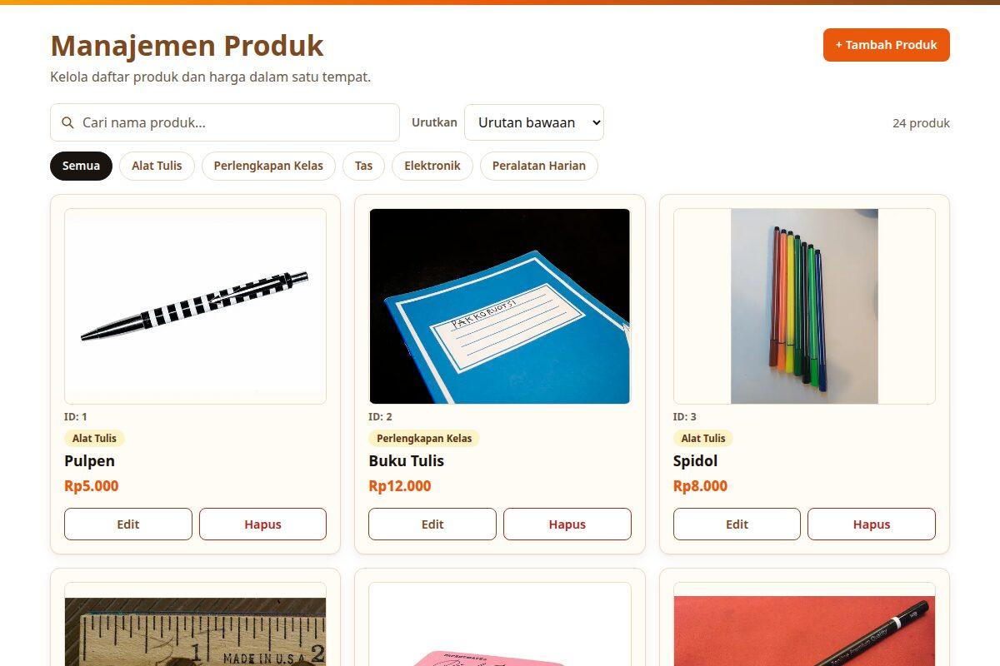

# Manajemen Produk

Tugas 3 Pemrograman Web (Week 11, Fundamental React): antarmuka "Manajemen Produk" dengan React.

| | |
|---|---|
| Mata kuliah | Pemrograman Web |
| NRP | 5027251091 |
| Tugas | Tugas 3, Fundamental React |
| Teknologi | React 19 (JavaScript/JSX), Vite, CSS biasa. Uji: Vitest dan Playwright |

## Cara menjalankan

Prasyarat: Node.js (LTS) dan npm.

```bash
npm install
npm run dev        # buka http://localhost:5173
npm run build      # build produksi ke folder dist/
npm test           # uji unit (Vitest)
npm run test:e2e   # uji end-to-end di Chrome (lihat catatan di bawah)
```

Uji end-to-end memakai Chrome yang sudah terpasang. Bila lokasinya bukan `/usr/bin/google-chrome`, isi variabel lingkungan `CHROME_PATH`. Opsi `--md berkas.md` menulis tabel hasil dan `--shots folder` menyimpan tangkapan layar tiap skenario.

## Fitur

**Sesuai mockup tugas**

- Header "Manajemen Produk" dengan tombol **+ Tambah Produk**.
- Kolom pencarian "Cari nama produk...", penghitung "N produk", dan "Menampilkan X dari Y produk".
- Kartu produk: ID, nama, harga berformat rupiah, tombol **Edit** dan **Hapus**.
- Pop-up **Tambah Produk**, **Edit Produk** (terisi data lama), dan **Hapus Produk?** (menampilkan produk dan peringatan tidak dapat dikembalikan).
- Validasi: nama wajib; harga harus angka bulat lebih dari 0.

**Fitur tambahan (tidak mengubah elemen inti)**

- Kategori produk (Alat Tulis, Perlengkapan Kelas, Tas, Elektronik, Peralatan Harian) dengan tombol filter.
- Katalog 24 produk bertema kehidupan sekolah dengan foto nyata (kredit dan lisensi di [`KREDIT-GAMBAR.md`](KREDIT-GAMBAR.md)).
- Gambar produk bersifat opsional: bisa diunggah saat tambah atau edit (diperkecil otomatis), produk tanpa gambar memakai gambar pengganti.
- Pengurutan nama dan harga.
- Data tersimpan di `localStorage` dan bertahan setelah muat ulang; tombol **Reset ke data awal**.
- Pemberitahuan (toast), tampilan saat hasil kosong, tampilan responsif, tombol Esc menutup pop-up.

## Pemetaan materi Week 11

| Materi | Penerapan | Lokasi |
|---|---|---|
| Komponen fungsi, nama diawali huruf besar | Seluruh komponen | `src/components/` |
| Komposisi komponen | Halaman menyusun header, pencarian, filter, grid, pop-up | `pages/HalamanProduk.jsx` |
| Atomic Design (opsional, slide 19) | `atoms`, `molecules`, `organisms`, `templates`, `pages` | `src/components/` |
| JSX: Fragment untuk elemen sejajar | Pop-up dan toast sejajar dengan `TataLetak` | `pages/HalamanProduk.jsx` |
| JSX: tag ditutup, `className`, atribut camelCase | ``, `<input ... />`, `onClick`, `onChange`, `strokeWidth` | `atoms/GambarProduk.jsx`, `molecules/KolomIsian.jsx`, `molecules/KotakCari.jsx` |
| Ekspresi `{ }` | `{formatHarga(produk.harga)}`, `{tampil.length}` | `organisms/KartuProduk.jsx`, `pages/HalamanProduk.jsx` |
| Props dan props fungsi (anak memberi tahu induk) | `produk`, `onEdit`, `onHapus`, `onTambah`, `onTutup` | `KartuProduk` ke `GridProduk` ke `HalamanProduk` |
| `map()` dengan `key` stabil | Kartu memakai `key={produk.id}` | `organisms/GridProduk.jsx` (juga `FilterKategori`, `PilihUrutan`) |
| Event handler: referensi vs pemanggilan | `onClick={tutupModal}` (referensi) dan `onClick={() => onHapus(produk)}` (fungsi panah) | `pages/HalamanProduk.jsx`, `organisms/KartuProduk.jsx` |
| `useState` | Daftar produk, pencarian, kategori, urutan, pop-up, toast | `pages/HalamanProduk.jsx` |
| Conditional rendering | `&&` (pop-up), ternary (tampilan kosong, label tombol), `return` dini (gambar pengganti) | `HalamanProduk.jsx`, `KeadaanKosong.jsx`, `GambarProduk.jsx` |
| State tidak dimutasi | `[...daftar, baru]`, `map`, `filter`, sort pada salinan | `HalamanProduk.jsx`, `utils/urut.js` |
| Data turunan dari state | Daftar tampil = saring lalu urutkan (bukan state ganda) | `HalamanProduk.jsx`, `utils/saring.js` |
| Trigger, render, commit | Mengetik di pencarian memanggil `setKataKunci` (trigger), React memanggil ulang komponen (render), lalu hanya bagian DOM yang berbeda yang diperbarui (commit) | alur seluruh aplikasi; hasilnya diverifikasi di uji e2e |

Di luar materi minggu ini: `useEffect` (tombol Esc, timer toast, penyimpanan), `useRef` (membuka pemilih berkas), `FileReader`/canvas (memperkecil gambar), dan `localStorage`.

## Struktur folder

```text
src/
  components/
    atoms/        Tombol, Lencana, GambarProduk
    molecules/    KotakCari, FilterKategori, PilihUrutan, BarPencarian,
                  KolomIsian, KolomPilihan, KolomGambar
    organisms/    KartuProduk, GridProduk, HeaderHalaman, Modal, FormProduk,
                  DialogHapus, KeadaanKosong, Toast
    templates/    TataLetak
    pages/        HalamanProduk
  data/           produk.js, kategori.js
  utils/          format, validasi, saring, urut, penyimpanan, gambar (+ berkas .test.js)
  styles/         theme.css, base.css
public/images/produk/   foto produk (WebP)
tests/e2e.mjs           uji end-to-end
docs/bukti/             tangkapan layar tiap skenario uji
```

## Pengujian

- **Uji unit (Vitest):** 26 uji untuk `formatHarga`, `validasiProduk`, `saringProduk`, `urutkanProduk`, dan `penyimpanan`.
- **Uji end-to-end (Playwright, Chrome):** 20 skenario pengguna. Hasil dari satu kali menjalankan `node tests/e2e.mjs --md hasil.md --shots docs/bukti`:

| No | Skenario | Hasil yang Diharapkan | Hasil Aktual | Status |
|---|---|---|---|---|
| 1 | Membuka halaman utama | 24 kartu produk, penghitung "24 produk", konsol bersih | 24 kartu, penghitung "24 produk" | Lulus |
| 2 | Mencari "pen" | Hanya produk yang namanya memuat "pen" | 6 kartu; "Menampilkan 6 dari 24 produk" | Lulus |
| 3 | Filter kategori Elektronik | Semua kartu berlencana Elektronik | 5 kartu, lencana: Elektronik | Lulus |
| 4 | Urutkan harga termurah | Penghapus (termurah) paling awal, Tas Laptop (termahal) paling akhir | awal: Penghapus; akhir: Tas Laptop | Lulus |
| 5 | Tambah produk yang valid | Jumlah menjadi 25, toast "ditambahkan", kartu baru Rp7.500 | 25 kartu; toast: "Penghapus Besar" ditambahkan; harga kartu: Rp7.500 | Lulus |
| 6 | Tambah dengan harga 0 ditolak | Pesan "Harga harus lebih dari 0", pop-up tetap terbuka, data tidak bertambah | pesan: "Harga harus lebih dari 0"; pop-up terbuka: true; kartu: 24 | Lulus |
| 7 | Tambah dengan harga huruf ditolak | Pesan galat harga angka; tidak ada produk dengan RpNaN | pesan: "Harga harus berupa angka bulat tanpa titik atau huruf"; kartu: 24 | Lulus |
| 8 | Tambah dengan nama kosong ditolak | Pesan "Nama produk wajib diisi" | pesan: "Nama produk wajib diisi" | Lulus |
| 9 | Tambah produk dengan gambar unggahan | Kartu baru menampilkan gambar hasil unggahan | src diawali "data:image/jpeg;base64..." (21319 karakter) | Lulus |
| 10 | Tambah produk tanpa gambar | Kartu memakai gambar pengganti (bukan gambar rusak) | gambar pengganti: 1; elemen img: 0 | Lulus |
| 11 | Berkas bukan gambar ditolak | Pesan "Berkas harus berupa gambar" | pesan: "Berkas harus berupa gambar" | Lulus |
| 12 | Edit produk | Form terisi data lama; kartu berubah menjadi Rp13.500; kategori tetap | terisi: Buku Tulis/12000/Perlengkapan Kelas; sesudah: Rp13.500, Perlengkapan Kelas; kartu: 24 | Lulus |
| 13 | Hapus produk dengan konfirmasi | Pop-up menampilkan produk; setelah konfirmasi jumlah 23 | dialog: Spidol; kartu: 23; Spidol masih ada: false | Lulus |
| 14 | Batal menghapus | Data tidak berubah | kartu: 24 | Lulus |
| 15 | Esc menutup pop-up | Pop-up hilang | sebelum Esc: 1; sesudah: 0 | Lulus |
| 16 | Perubahan bertahan setelah muat ulang | Produk tambahan masih ada dan Pulpen yang dihapus tetap hilang | Uji Persisten: true; Pulpen: false | Lulus |
| 17 | Data localStorage rusak | Halaman tetap tampil dengan 24 produk awal | 24 kartu tampil | Lulus |
| 18 | Reset ke data awal | Kembali ke 24 produk awal | kartu: 24; Uji Reset ada: false | Lulus |
| 19 | Tidak ada hasil pencarian | Pesan "Produk tidak ditemukan"; tombol hapus saringan memulihkan daftar | pesan: "Produk tidak ditemukan"; setelah hapus saringan: 24 kartu | Lulus |
| 20 | Tampilan ponsel 375 px | Tanpa gulir horizontal; kartu dua kolom | scrollWidth 375 dari 375; posisi atas dua kartu pertama: 392 dan 392 | Lulus |

Ringkasan: 20 dari 20 skenario lulus

Tangkapan layar tiap skenario ada di [`docs/bukti/`](docs/bukti/). Contoh:




## Catatan

- Harga produk hanya contoh.
- Foto berasal dari Wikimedia Commons dengan lisensi bebas; atribusi lengkap di `KREDIT-GAMBAR.md`. Foto Ransel Sekolah adalah ransel trekking karena tidak ada foto ransel sekolah berlisensi bebas yang bersih.
- Data tersimpan hanya di peramban pengguna (`localStorage`, sekitar 5 MB); gambar unggahan diperkecil ke 600 piksel agar muat.
- Pengujian dilakukan di Chrome pada Linux; belum di Firefox atau Safari maupun perangkat fisik.
