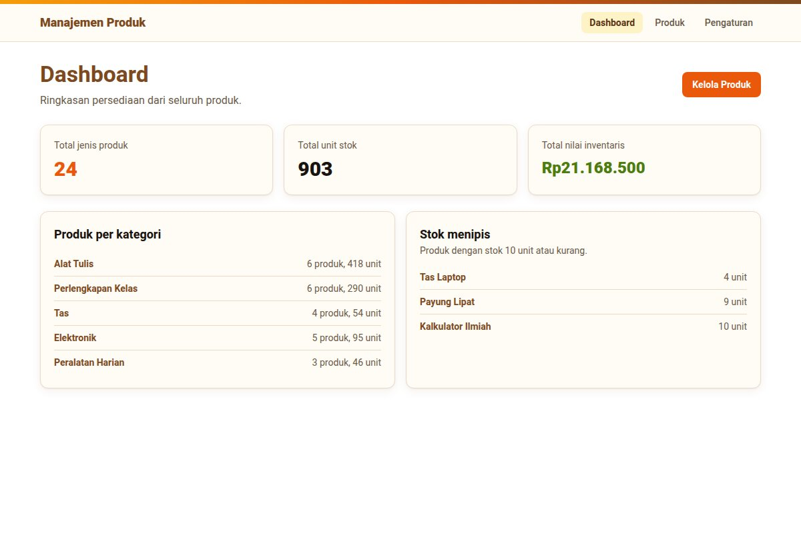
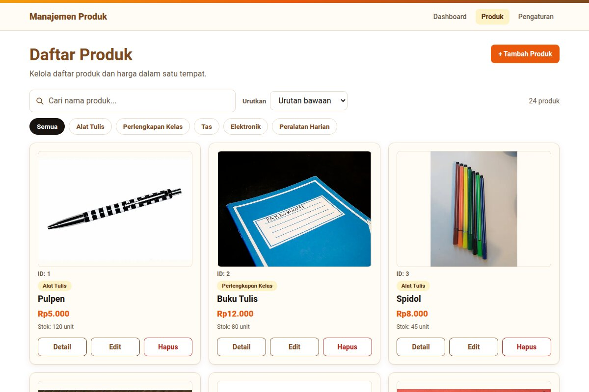
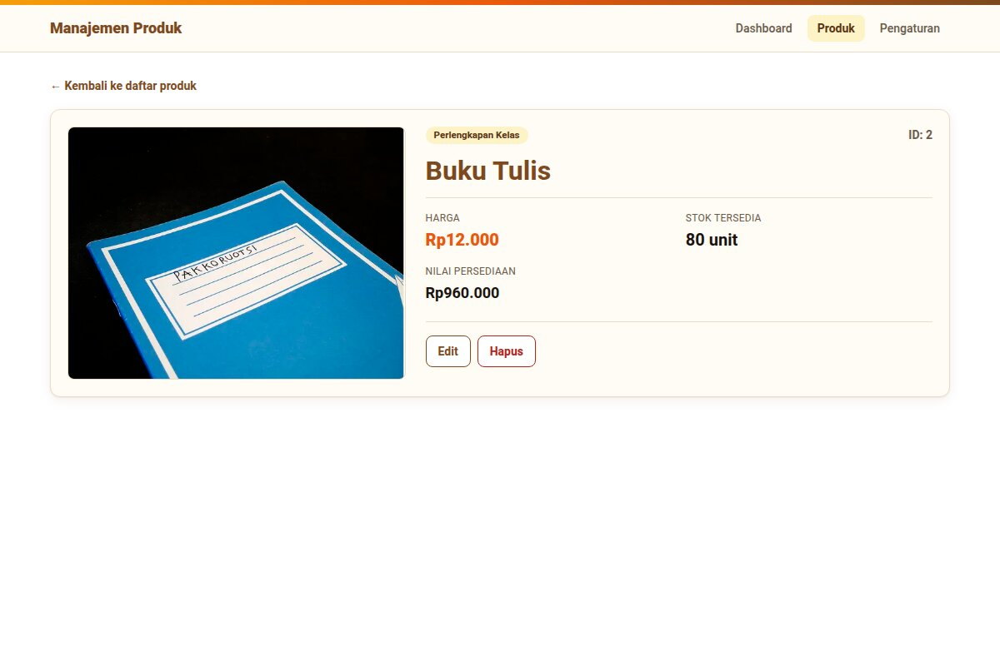
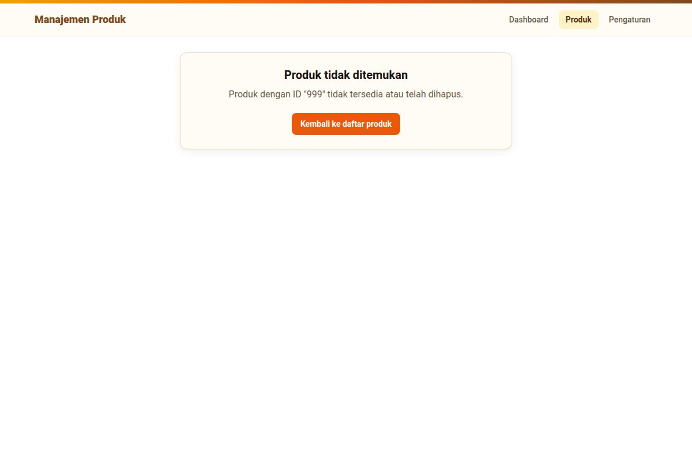
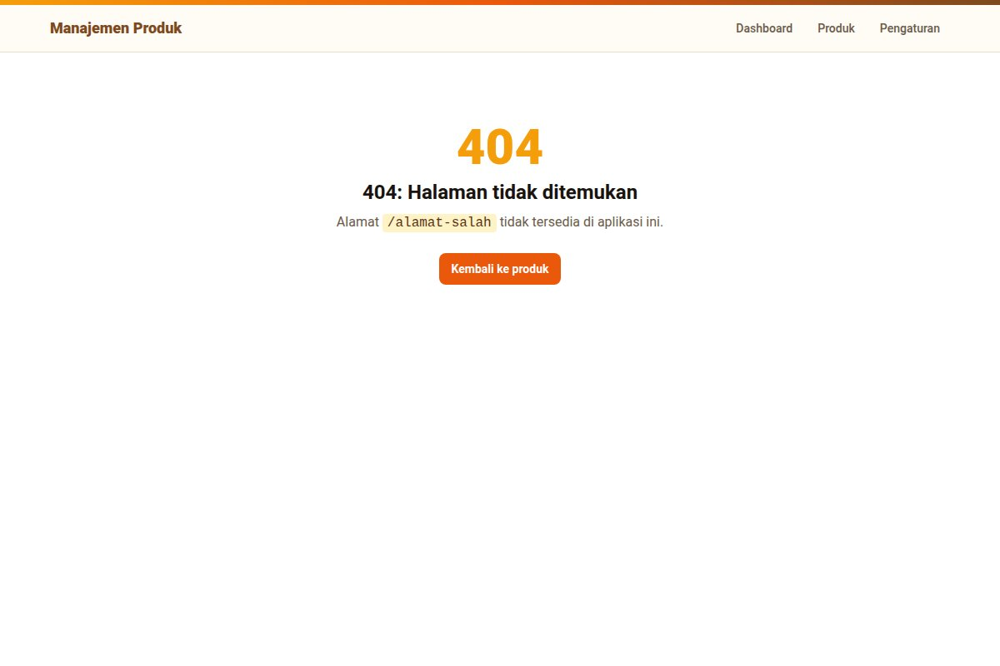
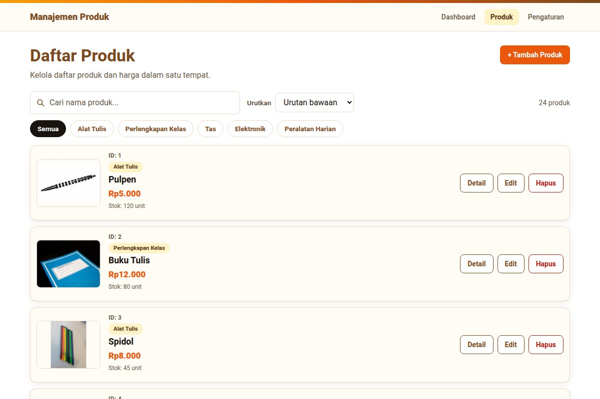
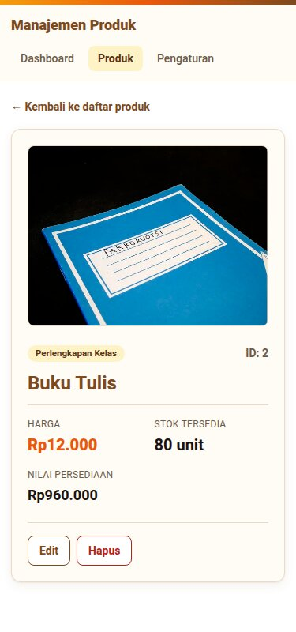

# Manajemen Produk

Aplikasi web multi-halaman untuk mengelola daftar produk dan persediaannya, dibuat dengan React. Pengguna dapat melihat ringkasan persediaan, mencari, menyaring, mengurutkan, menambah, melihat detail, mengubah, dan menghapus produk, dan semua perubahan tersimpan di peramban. Setiap halaman memiliki alamat URL sendiri sehingga dapat dibuka langsung, disimpan sebagai markah, dan tombol Back/Forward peramban berfungsi.

| | |
|---|---|
| Mata kuliah | Pemrograman Web |
| NRP | 5027251091 |
| Tugas | Tugas 4, React Router dan Tailwind CSS |
| Teknologi | React 19 (JavaScript/JSX), React Router 7, Tailwind CSS 4, Vite |

## Cara menjalankan

Prasyarat: Node.js (LTS) dan npm.

```bash
npm install
npm run dev        # buka http://localhost:5173
npm run build      # build produksi ke folder dist/
npm run preview    # menjalankan hasil build untuk dicoba
```

Catatan hosting: karena rute ditangani di sisi peramban, server produksi perlu mengarahkan alamat yang tidak cocok dengan berkas (misalnya `/products/2`) ke `index.html`. Server pengembangan Vite sudah melakukannya.

## Rute

| Alamat | Halaman | Isi |
|---|---|---|
| `/` | Dashboard | Total jenis produk, total unit stok, total nilai inventaris, ringkasan per kategori, dan daftar stok menipis |
| `/products` | Produk | Daftar produk dengan pencarian, filter kategori, pengurutan, serta tambah, edit, dan hapus |
| `/products/:id` | Detail Produk | Data produk sesuai ID, tautan kembali, serta tombol edit dan hapus |
| `/settings` | Pengaturan | Pilihan tampilan daftar produk: grid atau list |
| `*` | 404 | Pesan halaman tidak ditemukan dan tautan kembali ke produk |

`/alamat-salah` (alamat yang tidak dikenal) ditangani rute `*`. `/products/999` (rute valid tetapi produk tidak ada) ditangani halaman detail, yang menampilkan pesan "Produk tidak ditemukan" beserta tautan kembali.

## Fitur

### Inti Tugas

- Produk: **tambah**, **lihat** (halaman detail), **edit**, dan **hapus** dengan konfirmasi.
- Halaman detail `/products/:id` menampilkan data sesuai ID dan memiliki tautan kembali ke daftar produk.
- Halaman 404 dengan pesan yang jelas dan tautan kembali.
- Validasi: nama wajib; harga harus angka bulat lebih dari 0; stok harus angka bulat 0 atau lebih.
- Kolom pencarian "Cari nama produk...", penghitung "N produk", dan "Menampilkan X dari Y produk".

### Fitur extra

- Dashboard ringkasan persediaan yang ikut berubah saat produk ditambah, diubah, atau dihapus.
- Pengaturan tampilan daftar produk (grid atau list) yang tersimpan di peramban.
- Kategori produk (Alat Tulis, Perlengkapan Kelas, Tas, Elektronik, Peralatan Harian) dengan tombol filter.
- Katalog 24 produk bertema kehidupan sekolah dengan foto nyata (kredit dan lisensi di [`KREDIT-GAMBAR.md`](KREDIT-GAMBAR.md)) dan stok masing-masing.
- Gambar produk bersifat opsional: bisa diunggah saat tambah atau edit (diperkecil otomatis), produk tanpa gambar memakai gambar pengganti.
- Pengurutan nama dan harga; tombol **Reset ke data awal**.
- Pemberitahuan (toast) yang tetap tampil saat berpindah halaman, tampilan saat hasil kosong, tombol Esc menutup pop-up.
- Data tersimpan di `localStorage` dan bertahan setelah muat ulang; data versi lama (tanpa stok) dimigrasikan otomatis.

## Gaya tampilan

- Seluruh tampilan memakai kelas utilitas Tailwind CSS 4 langsung di JSX; tidak ada berkas CSS per komponen.
- Tema: latar putih dengan aksen kuning, oranye, cokelat, dan hitam. Warna, bayangan, dan animasi didefinisikan sekali sebagai token `@theme` di [`src/index.css`](src/index.css), sehingga otomatis menjadi kelas seperti `bg-oranye`, `text-cokelat`, `border-garis`, dan `shadow-kartu`.
- Variasi tampilan komponen (misalnya lima varian tombol) disimpan sebagai peta kelas utuh, bukan disusun dari potongan teks, agar Tailwind dapat menemukan kelasnya.
- Responsif: daftar produk berubah dari beberapa kolom menjadi dua kolom pada layar sempit, tombol filter dapat digeser ke samping, menu navigasi membungkus rapi, dan tidak ada gulir horizontal pada lebar 375 px.
- Aksesibilitas dasar: cincin fokus kuning untuk papan ketik, label dan pesan galat terhubung ke kolomnya, menu aktif ditandai `aria-current`, target sentuh minimal 44 px pada layar sentuh.

## Lokasi state bersama dan susunan komponen

- **State bersama** dipegang di [`src/App.jsx`](src/App.jsx), di atas `<Routes>`, supaya tidak hilang saat berpindah halaman: daftar produk, mode tampilan (grid atau list), dan pemberitahuan. Halaman menerimanya lewat props; perubahan dilakukan lewat fungsi `tambahProduk`, `ubahProduk`, `hapusProduk`, dan `resetData`.
- **State sementara** tetap di halaman yang memakainya: kata kunci pencarian, kategori, urutan, dan pop-up yang terbuka (di halaman Produk), serta pop-up edit atau hapus (di halaman Detail).
- **Penyimpanan:** daftar produk dan mode tampilan disimpan ke `localStorage` setiap kali berubah (`src/utils/penyimpanan.js`). Bila data rusak, aplikasi memakai data awal; bila penyimpanan penuh, muncul peringatan dan aplikasi tetap berjalan.
- **Data turunan** tidak disimpan sebagai state: daftar yang tampil dihitung dari data lengkap (disaring lalu diurutkan) dan angka Dashboard dihitung dari daftar produk (`src/utils/ringkasan.js`).

## Struktur folder

```text
src/
  main.jsx          titik masuk; membungkus App dengan BrowserRouter
  App.jsx           state bersama dan tabel rute
  index.css         impor Tailwind dan token tema
  layouts/          AppLayout (Navbar + Outlet)
  pages/            HalamanDashboard, HalamanProduk, HalamanDetailProduk,
                    HalamanPengaturan, HalamanTidakDitemukan
  components/
    atoms/          Tombol, Lencana, GambarProduk
    molecules/      Navbar, KotakCari, FilterKategori, PilihUrutan, BarPencarian,
                    KolomIsian, KolomPilihan, KolomGambar
    organisms/      KartuProduk, GridProduk, HeaderHalaman, Modal, FormProduk,
                    DialogHapus, KeadaanKosong, Toast
  data/             produk.js, kategori.js
  utils/            format, validasi, saring, urut, ringkasan, penyimpanan, gambar
public/images/produk/   foto produk (WebP)
docs/bukti/             tangkapan layar tiap skenario pengujian
```

Komponen dikelompokkan menurut ukurannya (atoms, molecules, organisms), kerangka halaman ada di `layouts/`, dan halaman yang menjadi target rute ada di `pages/`.

## Tampilan aplikasi

Dashboard:



Daftar produk (tampilan grid):



Detail produk pada `/products/2`:



Produk yang tidak ada pada `/products/999`:



Halaman 404 pada alamat yang salah:



Tampilan list yang dipilih di Pengaturan:



Tampilan layar ponsel (375 px):



Tangkapan layar lainnya ada di [`docs/bukti/`](docs/bukti/).

## Catatan

- Harga dan stok produk hanya contoh.
- Foto berasal dari Wikimedia Commons dengan lisensi bebas; atribusi lengkap di `KREDIT-GAMBAR.md`. Foto Ransel Sekolah adalah ransel trekking karena tidak ada foto ransel sekolah berlisensi bebas yang bersih.
- Data tersimpan hanya di peramban pengguna (`localStorage`, sekitar 5 MB); gambar unggahan diperkecil ke 600 piksel agar muat.
